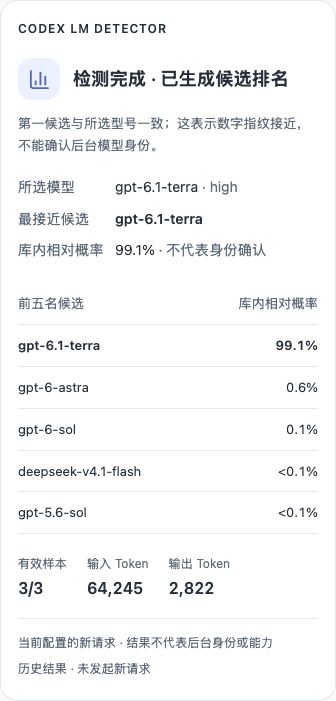
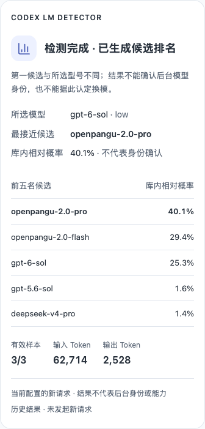
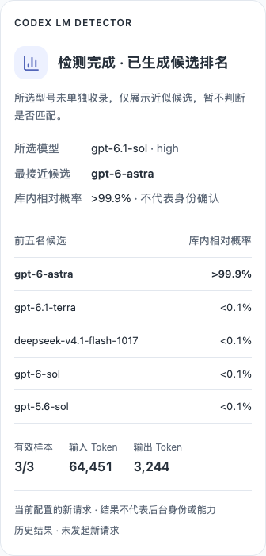
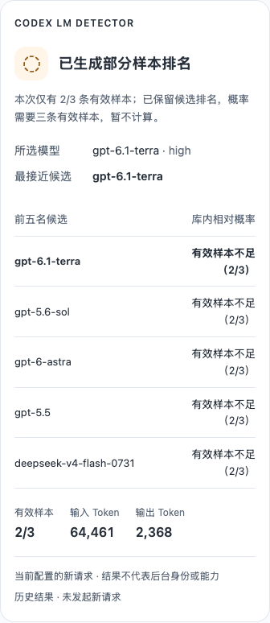

# codex-lm-detector

**在 Codex 里发一句话，看看当前模型的回答更像哪个模型。**

这是一个基于 [lm-detector](https://github.com/Ikaleio/lm-detector) 的非官方 Codex Skill（技能）。它自动沿用当前模型和渠道，无需另填 API 地址或密钥，检测后直接在聊天中显示候选排名。

## 1. 安装

准备好能正常聊天的 Codex，以及 [Node.js 22 或更高版本](https://nodejs.org/zh-cn/download)（推荐 LTS 版）。目前仅支持 Codex。

**复制下面两行，一起发给 Codex：**

```text
请使用 $skill-installer 安装这个仓库的 Skill：
https://github.com/logan0817/codex-lm-detector
```

等 Codex 提示安装成功，再进行下一步。如果提示已安装，请先查看[更新方法](references/usage.md#更新与卸载)。

## 2. 检测

**在要检测的 Codex 聊天中选好模型，发送：**

```text
$codex-lm-detector 检测当前模型
```

等待检测完成，Codex 桌面端会在一张结果卡片中显示结论、所选模型、前五名候选和 Token 用量。卡片下方的“查看完整报告”可打开本地记录。CLI 使用文字表格展示，无需手动复制提示词或模型回答。

每次检测会发送三条测试请求，**消耗当前 Codex 账号或渠道的额度**。

## 常用指令

在 Codex 聊天中发送即可，后面的中文可以按自己的习惯表达：

| 想做什么 | 复制到聊天中 | 发起模型测试请求 |
| --- | --- | --- |
| 检测当前模型 | `$codex-lm-detector 检测当前模型` | 是，三条挑战 |
| 检查连接和本地文件 | `$codex-lm-detector 只做诊断，不发起检测` | 否 |
| 复查以前的检测 | `$codex-lm-detector 复查这份历史报告，不重新检测：<报告绝对路径>` | 否 |

复查时，将 `<报告绝对路径>` 换成已有报告的完整路径，可从检测结果下方的“查看完整报告”找到。复查只重新分析已有回答，不会检测当前模型的新请求。诊断只检查环境和连接，不代替真实检测。

需要文字表格、JSON、自定义等待时间或保存目录时，查看[更多聊天用法](references/usage.md#聊天用法)。

## 结果示例

以下为历史结果缩略图，不代表模型身份认证。**点击图片查看原图。** CLI 展示相同内容的文字表格。

| 候选一致 | 候选不同 | 型号未单独收录 | 部分样本排名 |
| --- | --- | --- | --- |
| [](assets/examples/complete-same.png) | [](assets/examples/complete-different.png) | [](assets/examples/complete-unlisted.png) | [](assets/examples/partial.png) |
| 3/3 条有效样本；99.1% 为库内相对概率。 | 所选型号排第三，不能据此认定换模。 | 只展示近似候选，不判断型号是否匹配。 | 2/3 条有效样本；有排名，暂不计算概率。 |

## 结果怎么看

- **候选排名**：本次回答更接近参考库中的哪些模型。排名第一不代表已经确认真实身份，显示的概率也仅供库内比较。
- **型号未收录**：参考库里没有你选择的型号，只能看近似候选，不能判断是否匹配。
- **样本不足或检测失败**：这次没有足够证据，不能当作换模或“降智”的结论。

它比较的是沿用当前配置发出的新请求，不会复查聊天中以前的回答，也不能测量模型能力是否下降。

## 遇到问题

安装后找不到技能？先重新打开 Codex，再发送 `$codex-lm-detector 检测当前模型`。

检测报错时，先用上面的“只做诊断”检查连接和本地文件；常见错误的处理方式见[排障说明](references/usage.md#常见问题)。

实现面向 macOS、Windows、Linux；目前获得必要执行权限的 macOS 桌面端、macOS 交互式 CLI、Windows 桌面端和 Windows CLI 已完成真实检测。macOS 桌面端默认受限沙箱已复现报告目录不可写及子进程提前退出，Windows 默认受限配置也存在连接限制；使用时可仅批准本条检测命令，无需将整个会话改为完全访问，也不要只更换报告目录后自动重试。macOS 交互式 CLI 已验证完全访问及单条命令获批后的执行，受限沙箱内真实检测、macOS `codex exec` 和 Linux 尚未完成验证，详见[兼容性说明](references/usage.md#运行条件)。

## 更多说明

[手动安装](references/usage.md#手动安装) · [更新与卸载](references/usage.md#更新与卸载) · [报告保存位置与隐私](references/usage.md#报告与隐私) · [参数与排障](references/usage.md#命令与参数) · [开发与维护](references/usage.md#开发与维护)

## 许可与致谢

采用 [MIT License](LICENSE)。感谢 [lm-detector](https://github.com/Ikaleio/lm-detector) 提供挑战生成、参考库和评分器。

SDK 和参考库的版本与许可见 [lm-detector 组件说明](THIRD_PARTY_NOTICES.md)。本项目为非官方项目。
